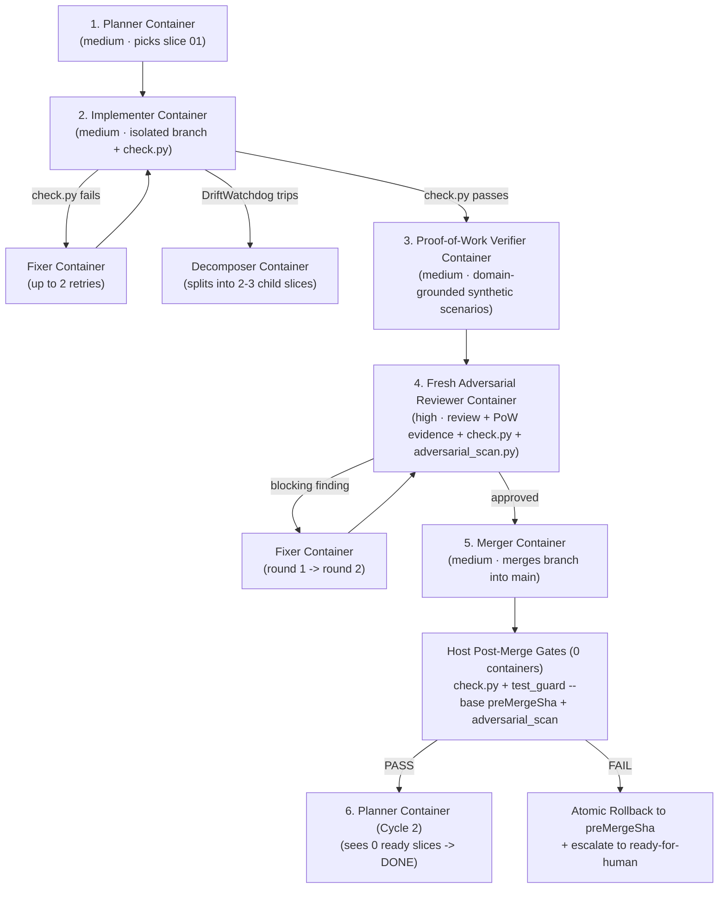
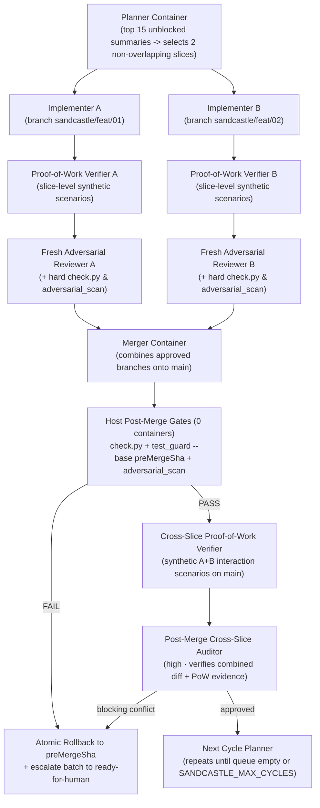

# Sandcastle Workflow Diagrams (Single-Slice & Multi-Slice)

Visual reference for how agents, Docker containers, deterministic gates, and the **Proof-of-Work Verifier** execute across single-slice and multi-slice runs.

---

## 1. Single-Slice Lifecycle

---

## 2. Multi-Slice Parallel Lifecycle (`MAX_PARALLEL = 2`)

---

## 3. Container & Agent Count Summary (Happy Path)

| Scenario | Containers / Agent Runs (PoW On, Default) | Max Concurrent Containers | Notes |
| --- | --- | --- | --- |
| **1 Slice** | **6** (Planner c1 → Implementer → PoW Verifier → Reviewer → Merger → Planner c2) | **1** | Cross-slice PoW & Post-Merge Auditor are skipped for 1 slice. |
| **10 Slices** (5 cycles × 2 parallel) | **46** (`5 × [1 Planner + 2 Implementers + 2 PoW + 2 Reviewers + 1 Merger + 1 Cross-Slice PoW + 1 Post-Merge Auditor]` + `1` final empty Planner) | **2** (`MAX_PARALLEL = 2`) | Set `SANDCASTLE_MAX_CYCLES=15` for headroom; disable PoW via `SANDCASTLE_POW_QA=0` if needed. |

*(Host post-merge gates — `check.py`, `test_guard.py`, `adversarial_scan.py` — run directly on the host with 0 containers.)*
